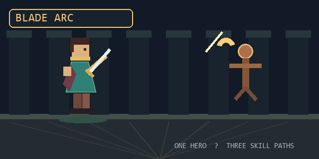
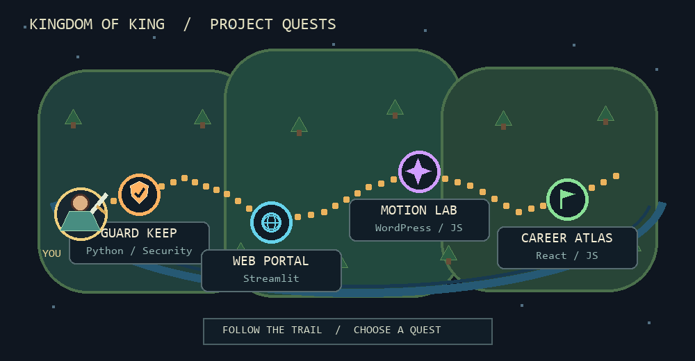

<h1 align="center">⚔ KING's Developer Quest Log</h1>

A working adventurer's map of security tools, web apps, and creative builds.

<a href="https://github.com/MeKing777?tab=repositories">🗺 Explore all repositories</a> · <a href="https://github.com/MeKing777">👤 Character profile</a>

## 🗡 Skill attacks in action

**Blade Arc** · **Python Fireball** · **Web Lightning** — three combat styles, inspired by the tools I build.

## 🗺 The project overworld

### Choose a quest

| Map location | Project | Skill loadout |
| --- | --- | --- |
| 🛡️ **Guard Keep** | [Phishing & Spam Guard](https://github.com/MeKing777/phishing-spam-guard) | Python · email and URL security |
| 🌐 **Web Portal** | [Phishing & Spam Guard Web](https://github.com/MeKing777/phishing-spam-guard-web) | Python · Streamlit · web scanning |
| ✨ **Motion Lab** | [Motion Studio](https://github.com/MeKing777/motion-studio) | WordPress · PHP · JavaScript |
| 🚩 **Career Atlas** | [AI Career Roadmap](https://github.com/MeKing777/career-road-map) | React · Vite · JavaScript |

## 🎒 Character loadout

**Class:** Software builder · **Main skills:** Python, JavaScript, HTML, WordPress · **Play style:** Learn by building, then keep improving.

---

Pick a quest, explore the code, and follow the build.
