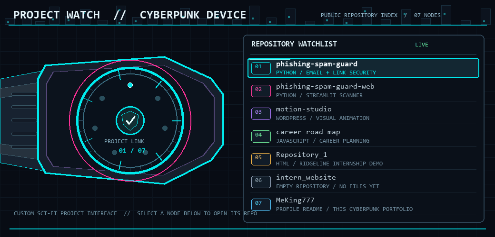

<p align="center">
  
</p>

<p align="center"><code>UPLINK: ONLINE</code> &nbsp; <code>OPERATOR: KING</code> &nbsp; <code>SECTOR: SOFTWARE / SECURITY</code></p>

---

### 01 // CONTRIBUTION PULSE

<p align="center"><a href="https://github.com/MeKing777?tab=overview"></a></p>

<p align="center">
  <a href="https://github.com/MeKing777?tab=repositories"></a>
  <a href="https://github.com/MeKing777?tab=overview"></a>
</p>

<sub>Live profile cards by <a href="https://github.com/vn7n24fzkq/github-profile-summary-cards">github-profile-summary-cards</a>. Open the chart to see the full GitHub activity page.</sub>

### 02 // PROJECT WATCH

<p align="center"></p>

The watch cycles through every **public repository**. Pick a channel to open the code:

| Channel | Repository | Readout |
| --- | --- | --- |
| `01 / DEFENSE` | [Phishing & Spam Guard](https://github.com/MeKing777/phishing-spam-guard) | Python security tools for suspicious messages and links. |
| `02 / WEB DEMO` | [Phishing & Spam Guard Web](https://github.com/MeKing777/phishing-spam-guard-web) | Public Streamlit scanner for submitted text and URLs. |
| `03 / CREATIVE` | [Motion Studio](https://github.com/MeKing777/motion-studio) | WordPress visual editor for animation, effects, and layouts. |
| `04 / CAREER TECH` | [Career Road Map](https://github.com/MeKing777/career-road-map) | React/Vite career-planning project. |
| `05 / WEB BUILD` | [Repository_1](https://github.com/MeKing777/Repository_1) | Ridgeline Trail Co. frontend internship project. |
| `06 / OPEN SLOT` | [intern_website](https://github.com/MeKing777/intern_website) | Public repository is currently empty. |
| `07 / PROFILE HQ` | [MeKing777](https://github.com/MeKing777/MeKing777) | This profile and its cyberpunk project log. |

### 03 // TECH DECK

<p align="center">
  
  
  
  
  
  
</p>

### 04 // BUILD PROTOCOL

```text
01  Find a real problem.
02  Build something useful.
03  Test it, learn, and upgrade the system.
```

<p align="center"><a href="https://github.com/MeKing777?tab=repositories"></a></p>

---

<p align="center"><sub>Original sci-fi project-watch artwork. Animated neon skyline: adapted from Einoshima's <a href="https://commons.wikimedia.org/wiki/File:Neon_header_background.gif">Wikimedia Commons</a> image · CC0 1.0</sub></p>