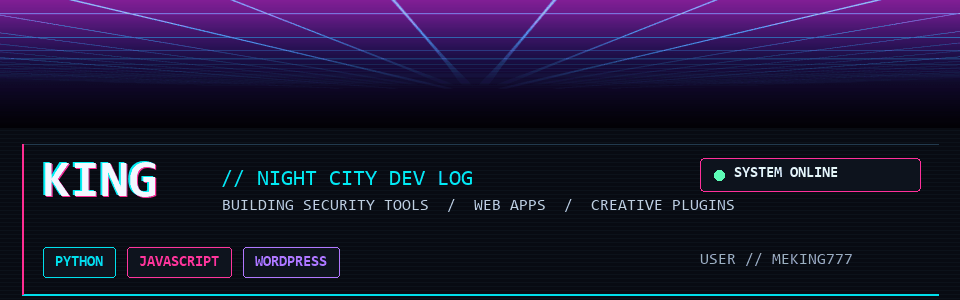

<p align="center">
  
</p>

<p align="center"><code>UPLINK: ONLINE</code> &nbsp; <code>OPERATOR: KING</code> &nbsp; <code>SECTOR: SOFTWARE / SECURITY</code></p>

---

### 01 // UPLINK

I build practical tools for a safer, more useful web - from suspicious-link checks to creative WordPress tools. This is my public build log: projects, experiments, and the skills behind them.

<p align="center">
  <a href="https://github.com/MeKing777?tab=repositories"></a>
  <a href="https://github.com/MeKing777?tab=projects"></a>
</p>

### 02 // ACTIVE OPERATIONS

| `01 / DEFENSE` | `02 / PUBLIC TERMINAL` |
| --- | --- |
| **[Phishing & Spam Guard](https://github.com/MeKing777/phishing-spam-guard)**<br>Python security toolkit for checking suspicious messages and links, with local Windows tools. | **[Phishing & Spam Guard Web](https://github.com/MeKing777/phishing-spam-guard-web)**<br>Public Streamlit demo for scanning text and URLs submitted by visitors. |
| `03 / CREATIVE SYSTEMS` | `04 / CAREER TECH` |
| **[Motion Studio](https://github.com/MeKing777/motion-studio)**<br>WordPress visual editor for animation, effects, and page layouts. | **[Career Road Map](https://github.com/MeKing777/career-road-map)**<br>React and Vite project exploring career planning. |

### 03 // TECH DECK

<p align="center">
  
  
  
  
  
  
</p>

### 04 // BUILD PROTOCOL

```text
01  Find a real problem.
02  Build something useful.
03  Test it, learn, and upgrade the system.
```

### 05 // NETWORK

- [All repositories](https://github.com/MeKing777?tab=repositories)
- [Phishing & Spam Guard Web demo](https://github.com/MeKing777/phishing-spam-guard-web)

---

<p align="center"><sub>Animated neon skyline: adapted from Einoshima's <a href="https://commons.wikimedia.org/wiki/File:Neon_header_background.gif">Wikimedia Commons</a> image · CC0 1.0</sub></p>